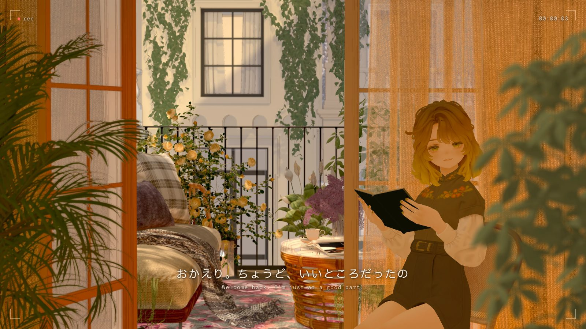

# Your LoFi Girlfriend



**Live: https://yourlofigirl.com**

A lofi companion for the web. A girl reads on a sunny balcony while the music plays; now and then she looks up and
talks to you.

It is also an experiment, to see what people can build together: characters, motion, animation, conversations,
scripts, scenes, music, anything. If you want to add something, start at [Contributing](#contributing).

Front end only: three.js and three-vrm, no server, no tracking.

## Features

- **Reading that never loops**: eyes along the lines, page turns, look-ups, glances, breathing, small posture shifts,
  and a short break every 4 to 8 minutes (book on her lap, shoulder rolls, head tilts with her eyes closed).
- **Greeting**: one of five lines at random as the picture comes into focus, never the same as last visit.
- **Small talk** every 1 to 2 minutes: 32 lines about her small days, quiet thoughts and the philosophy book she is
  reading, some to you, some murmured to herself with a glance aside.
- **Click to talk**: usually a warm word, about one time in three a caring question with two or three answers to pick
  and a reply to your pick; subtle motion (a curious tilt while she waits, a nod when you answer).
- **Voice**: VOICEVOX 冥鳴ひまり, mouth on the sound, subtitles in Japanese and English, the music dipping while she speaks.
- **Camera frame and music**: a quiet HUD with a counter, level bars, play, pause, skip, volume and a playlist of
  CC-licensed lofi tracks; media keys and phone controls work.
- **Wind**: the palm, near leaves and potted plants sway in one wind across the painted picture.
- Works on phones; keyboard reachable; nothing is sent anywhere (her memory of what you heard stays in your browser).

## Quick start

With Node 22.12 or newer:

```sh
git clone https://github.com/lightmanM/Your-LoFi-Girlfriend.git
cd Your-LoFi-Girlfriend/web
npm ci
npm run dev
```

Open http://127.0.0.1:5173/. A fresh clone runs with **stand-ins** (below): a free stand-in character in the same
balcony, without music. Test switches such as `?intro=0`, `?ask=q-meal` or `?talkevery=20` are listed in
[web/README.md](web/README.md).

## Stand-ins: what this repository includes

The full site uses a purchased character and 3D files from a purchased scene, which cannot be redistributed. So that
anyone can run and develop the project, the repository carries stand-ins, and the page uses them automatically
whenever the full files are missing (`?standin=1` forces them, to preview what a clone sees).

| On the live site | In this repository | Why |
| --- | --- | --- |
| Marycia (©BeroarN, purchased) | **Vivi**, pixiv's free VRoid sample (CC0), fitted to the chair and book | Marycia's licence does not allow redistribution |
| The balcony's rendered picture, layers and wind maps | **The same renders**, shared for this project only | See the terms below |
| The balcony's chair and plant meshes | **Rebuilt**: a two-panel chair and flat plant cards cut from the plant mask | The meshes come from purchased libraries |
| Lofi music | **Not included** (the page shows "no music in this copy") | Tracks are not redistributed; `scripts/music/` rebuilds them from their sources |

**Need the full resources for serious contribution?** Email **lightman.miao@gmail.com**.

## Deploy

The page is a static site: `npm run build` (in `web/`) writes it to `web/dist/`. Everything in `web/public/` is
published with it, so only deploy files you have the right to publish.

**Cloudflare Pages** (where yourlofigirl.com runs):

- **From Git** (the stand-in version, as in this repository): create a Pages project connected to this repository,
  with root directory `web`, build command `npm ci && npm run build`, output directory `dist`, and the environment
  variable `NODE_VERSION` = `22`.
- **With your own files** (as the live site is published): build on the machine that has them, check `web/dist/`,
  then upload it directly:

  ```sh
  cd web && npm ci && npm run build
  npx wrangler login                                   # once
  npx wrangler pages deploy dist --project-name <your-project>
  ```

Pages answers a missing file with the site itself; the page notices and falls back to its stand-ins, so a partial
copy still runs.

## Contributing

Issues and pull requests are welcome; [CONTRIBUTING.md](CONTRIBUTING.md) has the rules (above all: only add files you
have the right to redistribute). Some places to start:

- **Characters**: bring your own VRM. `web/public/standin/standin.json` places a character (scale, seat, small pose
  corrections); `scripts/standins/compress_vivi.py` shows how Vivi, a VRM 0.x model, was compressed and turned to face
  forward like a VRM 1.0 model. A character switcher would be welcome.
- **Motion and animation**: reading, page turns, looks and the break in `web/src/balcony/` (`reader.js`, `reading.js`,
  `unwind.js`), breathing in `web/src/companion/life.js`, motion while she speaks in `web/src/voice/`. New gestures,
  idle behaviours and transitions are all open.
- **Conversations and voice**: lines live in `scripts/voice/lines.json` (greetings, small talk, questions, replies);
  `scripts/voice/generate_lines.py` voices them with the VOICEVOX app. Please keep within
  [冥鳴ひまり's terms](https://meimeihimari.wixsite.com/himari/terms-of-use).
- **Scripts and pipelines**: Blender scripts that render the picture and export the scene (`scripts/balcony-*`), the
  character conversion (`scripts/marycia/`), motion tools (`scripts/motion/`), the music encoder (`scripts/music/`).
- **More scenes**: today one scene is described by `web/public/environment/balcony-toon/scene.json` (camera, picture
  layers, wind maps, where she sits). Supporting a second scene means a folder like it and a way to choose between them
  in `web/src/viewer/main.js`.
- **Music, accessibility, performance, phones**: all fair game.

Before a pull request, run the checks in [web/README.md](web/README.md#verify). `scripts/standins/clone_check.sh`
runs everything as a fresh clone would (no private files): the stand-in suite should pass there.

Design notes, specs and plans are in [docs/](docs/README.md).

## Layout

| Path | What |
| --- | --- |
| [`web/`](web/README.md) | The page: run, test, build, deploy, test switches |
| `web/public/standin/` | The stand-ins: Vivi, her placement, the chair, the reading pose |
| `scripts/voice/`, `scripts/music/` | Her lines and the VOICEVOX generator; the music list and encoder |
| `scripts/standins/` | Vivi's compression, the chair measurement, the clone check |
| `scripts/marycia/`, `scripts/balcony-*/`, `scripts/motion/` | Character conversion and the Blender scene scripts |
| [`docs/`](docs/README.md) | Design notes, specs and plans |

## Credits and licence

- **Code and docs**: [MIT](LICENSE).
- **Balcony renders** (`web/public/environment/balcony-toon/*.webp`) and the screenshot above: © the project owner;
  included so this project runs; you may use them to run and develop this project, not reuse them elsewhere or
  redistribute them separately; not covered by the MIT licence.
- **Stand-in character**: Vivi, pixiv Inc. (VRoid Project), CC0 ([record](web/public/standin/CREDITS.md)).
- **Voice**: VOICEVOX:冥鳴ひまり. **Music**: Lao Ban (CC0) and VibeDepot (CC BY-ND 4.0) via Free Music Archive, credited
  on the page. **Live site's character**: Marycia ©BeroarN.

Full details: [CREDITS.md](CREDITS.md).
